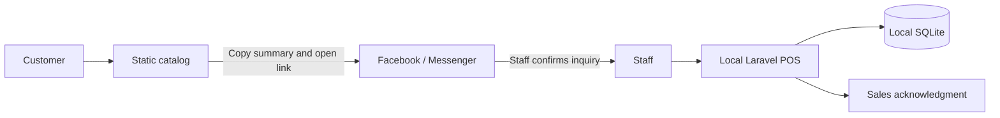

# Architecture and design direction

This is explanatory design documentation, not a full ISO/IEC/IEEE 29148 requirements specification. IDs and verifiable acceptance criteria are maintained in [REQUIREMENTS.md](REQUIREMENTS.md); formal architecture viewpoints and validation records are simplified.

## Two applications

The catalog is independent static HTML, CSS, and JavaScript. It fetches public JSON and keeps only SKU/quantity pairs in browser local storage. It does not capture customer names, contact details, addresses, payment information, or documents. It does not confirm stock or automatically submit orders. Its only external handoff is a user-initiated configured Facebook/Messenger link.

The Laravel app uses Blade, Vite, and PDO SQLite on one store host. Connected phones, tablets, and computers send requests to that host through store Wi-Fi/Ethernet. SQLite remains on the host's local disk; it is never shared as a network file. Internet is optional for local operations, but loss of the host or local network prevents checkout. There are no offline browser replicas or synchronization queues.

The manual launcher runs `php artisan serve --host=0.0.0.0 --port=8000 --no-reload --no-ansi` in the background. PHP can be reused while Laragon's application stays closed. Root launchers generate settings/logs in ignored `.runtime/artisan` and verify PID, executable path, and start timestamp before stopping the owned process tree. The child process sets SESSION_SECURE_COOKIE=false and uses a nonexistent APP_CONFIG_CACHE path so cached settings cannot override the HTTP demo configuration; .env is unchanged. Artisan serves Laravel public using its framework router. No service or startup task is installed. This user-approved HTTP setup is for sample-data demonstrations on trusted Wi-Fi; production HTTPS is deferred. See LOCAL_DEPLOYMENT.md for private-subnet firewall preparation.

The app uses Manila dates. SQLite's configured busy timeout is 5 seconds; checkout transactions stay short. Simultaneous writes take turns; displayed stock can be stale, but the conditional server deduction validates stock at checkout. MySQL may be considered later if concurrency grows, with tested schema and data migration. Report/inventory pages require refresh to reflect another device's transactions.

## Checkout and inventory

Server validation limits line count and quantities, rejects duplicate product IDs, and accepts cash with at most two decimal places. Prices are fetched from the active product record. Monetary arithmetic uses integer centavos.

Within one transaction, physical stock is reduced through an atomic conditional update (`stock >= requested quantity`). Failure on any item, insufficient payment, or an invalid item rolls back the whole sale. The sale, snapshot item records, and stock movements are committed together. A unique UUID request reference makes repeated submission return the existing sale for its cashier, preventing repeated deductions.

Inventory includes products, services, and internal supplies (consumable). Internal supplies are excluded from sales and charged orders. Owner-only restocking and manual supply usage record quantity, staff, timestamp, and reason. Edits change future pricing/details; existing order/receipt snapshots preserve names, SKUs, prices, and quantities. Items are deactivated rather than deleted. Paid refunds/voids, discounts, tax calculations, supplier purchasing, and payment gateways remain outside scope.

## Confirmed orders and payments

The approved 0.4.0 amendment adds local staff-entered pickup/delivery orders with customer/contact/address, preparation notes, agreed delivery fee, and price snapshots. Unpaid confirmed orders increment product reservations atomically. Available stock equals stock minus reserved; counter checkout and supply usage validate that available quantity. Reservations persist during unpaid COD dispatch, so stock total can include goods with a courier and is not a physical shelf count.

Prepaid orders collect cash or verified GCash at creation; COD/collection orders remain unpaid until staff records collection. Payment deducts stock, releases reservations, creates a unique paid sale/receipt using order snapshots, and records paid_by in one transaction. Sales stay attributed to the order creator so cashier access/reporting remains consistent. The payment collector is recorded separately. Paid receipts include item subtotal and delivery fee; unpaid orders never enter sales revenue. Reports separate cash and GCash collected sales totals.

GCash is manual: staff verify the incoming payment in the store account and provide a transaction reference and confirmation. The recorded amount must equal the total; GCash has no change calculation. References are normalized to uppercase and have a unique database constraint across counter/order sales. Duplicate order/checkout references and repeat payment return existing records. No GCash credentials, API, screenshot uploads, or automatic external verification are used.

Status advances preparing → ready → out for delivery → delivered, or ready → picked up for pickup orders. Completion requires payment. Unpaid cancellation releases reservations once and records a reason; dispatched cancellation also requires confirmation that goods returned. Paid refunds and cancellations require future approved work. Owner can access all orders; cashier accesses only orders they created. Customer details/notes are validated and escaped and remain outside the static catalog.

## Access and operations

Guests can access only the login page. Owners access the dashboard, inventory, all sales, and all receipts. Cashiers access checkout and their own sales/receipts. Role checks run on the server, not just in navigation. Login is rate-limited, passwords are hashed, and POST/PUT web routes use Laravel CSRF protection. Sessions regenerate on login and invalidate on logout.

Staff accounts are provisioned from the local console with hidden password entry. The seed command creates sample products, not staff credentials. Re-seeding does not reset existing quantities/prices. Browser QA has its own database and random ephemeral password.

Database tables: users, products, sales, sale_items, stock_movements, orders, order_items, plus Laravel's generated session/cache/job tables. Foreign keys preserve inventory and historical references. The additive migration initializes existing reservations/fees to zero and historical payment methods to cash. Actual store data, `.env`, dependencies, cache, build output, private backups, and QA artifacts are excluded from source control.

## Visual direction

**Audience:** students browsing affordable essentials; cashiers working quickly; an owner checking stock and daily sales. **Purpose:** prepare inquiries and keep local store records reliable. **Tone:** warm, prepared, calm, approachable.

The catalog uses a stationery-inspired editorial layout: a focused serif hero, original SVG school-supply illustrations, warm paper surfaces, muted school-supply art, and navy calls to action. The user-approved 0.4.1 refresh uses the original colorful Plan.docx emblem in both applications, with yellow accent details and warm-white surfaces. Locally installed Segoe UI/Arial keeps the staff workspace legible without external fonts. Original PNG copies are unchanged; CSS frames the emblem on screen. Logo text is accompanied by an accessible store name in navigation. No external fonts or image services are required, so the defense UI works offline.

### Current staff direction — 0.5.0

The user accepted a clean retail workspace for cashiers and the owner: efficient, trustworthy, and comfortably readable. Staff CSS is consolidated rather than layering more compact overrides. The catalog keeps its existing stationery presentation. This is design guidance, not a full ISO/IEC/IEEE 29148 specification; REQ-021 supplies the current measurable criteria and supersedes the earlier strict short-window fitting rules.

Staff body/input text is 16px, table data 15px, secondary/help text 13–14px, product names 18px, prices 24px, and page titles 28–32px. A 244px desktop sidebar and 400px checkout column give navigation and payment a stable place. Mid-sized desktops use 224px/380px columns; tablets wrap visible navigation and phones stack content. Related fields are grouped with headings or fieldset legends. Local, decorative SVG icons use a consistent 24px viewBox and 1.8px strokes; accessible names remain in text. A live basket count helps confirm additions without searching the lines.

POS panels fit below the 64px header from 1101px width/720px height. Products and checkout details scroll separately; totals/actions remain outside the scrolling details. Smaller windows use natural document flow and a bounded basket/product list, with ordinary focus scrolling preserving keyboard access. Empty baskets end at their footer. Tables have readable rows, sticky headings, bounded overflow and named keyboard-focusable regions. Screenshots and assertions check these rules instead of forcing every page into one viewport.

- Spacing follows 4/8/12/16/20/24/32/48px increments. Staff content uses 20–24px grouping rather than tiny padding.
- Cards use 13–16px corners; buttons and inputs use 8–10px corners.
- Shadows are restrained; borders group records and controls.
- Navy communicates primary actions; yellow accents echo the logo; green communicates successful/paid/completed states; amber flags low stock/demo content; red indicates errors. Status text accompanies color.
- Keyboard focus uses a high-visibility warm brown outline. Controls are labeled, dialogs use native focus management and Escape, and mobile layout stacks dense panels with tables inside scroll containers.
- Most transitions are 160ms. Reduced-motion preferences suppress animation and smooth scrolling.
- Printing hides navigation and actions and formats the receipt for an approximately 80mm content width. Users select the actual printer/paper size in their browser's print dialog.

Automated browser checks cover desktop/mobile overflow, interactions, keyboard flow, console errors, and axe rules. Screenshots support a visual polish pass; these checks are not a claim of complete WCAG certification.

Historical behavior, superseded by REQ-021: in the 0.4.3 correction, short-screen empty-basket copy uses a compact line and reduced padding while controls retain their touch sizes. Validation-error pages use natural height with bounded products, so alerts cannot consume the fixed panel space needed to correct an input and resubmit. Browser checks verify correction and submission at 1024x560 after a rejected GCash reference.

Historical compact layout (0.4.2/0.4.3, superseded by the approved 0.5.0 direction above): it prioritized cashier speed and an uncluttered workspace. Staff headings are 26px; 12–18px padding groups related content without reducing input/button touch targets below 44px. Laptop POS height is the viewport minus the 52px topbar; its heading and notices consume space before the two panels share the remaining height. Product tiles and checkout details have independent scroll regions, while checkout totals and submission remain outside the scrolling body. The fitted layout operates from 1001px width/560px height in CSS pixels. Smaller windows use natural page scrolling, a bounded product list, and a naturally sized basket; the basket never stretches to product-list height. Short desktop navigation scrolls internally to preserve sign-out access. Tablets use two POS columns from 768px; phones stack panels and bound the product list height. List tables retain headings during internal scrolling and expose labeled, keyboard-focusable regions. The low-stock list has a bounded scroll region matching the compact chart. Receipt printing and the public catalog retain their existing layouts. REQ-019/020 provide measurable acceptance criteria. The user screenshot appears to represent 1280x632 CSS pixels at 1.5 pixel scale; the comparison fixture tests that layout without claiming to identify their actual zoom or display setting.

The historical 0.4.0 staff refinement used the green/paper palette and added compact product cards and a phone basket shortcut. The approved 0.4.1 refresh updates branding and increases table/form/navigation readability, with desktop product and checkout scroll regions and stacked tablet/phone layouts. Tablets and phones retain sign out and the basket shortcut. Payment fields appear only for immediate collection; delivery fields appear only for delivery. New order selects pickup through a permitted query value; validation-flashed fulfillment overrides that initial value. Inventory movement routes derive dialog context on the server; failed validation reopens that dialog with escaped inputs and errors. A hidden Active=0 input preserves unchecked state across validation. GCash references are trimmed/uppercased on blur and still validated/normalized on the server. Returning to a submitted checkout through the browser cache refreshes its request reference and displayed inventory. No new dependency, database migration, or deployment change is needed.
