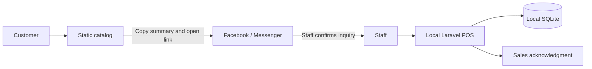

# Accepted cloud architecture — 2.0.1

REQ-037–042 supersede the historical local-only hosting boundary for the new application. This design uses simplified ISO/IEC/IEEE 29148 traceability. Existing local architecture below remains the fallback and historical record.

Cloudflare serves public static files only: the guest catalog at `/` and the staff PWA at `/staff/`. Supabase Auth identifies staff; PostgreSQL read-only row policies and guarded transactional RPCs enforce Admin/Cashier roles. Cashier administration runs in a JWT-validated Edge function with its service-role credential confined to the server. Every authenticated database operation checks an active profile, the JWT session ID against `auth.sessions`, and a password-reset revocation marker. Guest access is limited to an active-product catalog projection, without staff, customer or payment records.

IndexedDB commits an immutable event and its local projection before showing a saved result. Events have UUID identity, a device sequence and captured timestamp; the server checks full identity on retries, applies an event once and retains rejected payloads for review. A fresh server snapshot replaces the base state while unsynchronized events are replayed locally. Accepted envelopes survive until a snapshot confirms inclusion. Reconciliation never silently changes receipt numbers, prices or GCash references.

An explicit review retry gets a new UUID/sequence while retaining the original `captured_at`, including when the user approves the current record version. Local and server resolution compare that captured business date as well as financial details. The original review and the replacement's server-receipt timestamp remain audit evidence. This prevents recovery on a later day from moving sales/payment revenue to that day.

Admin allocates stock to a Cashier device while online. Stock equals free plus reserved plus allocated units; offline sales spend only that device's allocation. Unpaid orders move allocated units into reservation; payment deducts stock exactly once; eligible cancellation returns units to the same device. Each order has one editing-device lease. A device must synchronize and resolve reviews before releasing allocation or a lease; ambiguous online results block further mutations until refresh. Web Locks serialize network operations across tabs; IndexedDB transactions serialize local mutation. Browsers lacking Web Locks cannot perform shared-state releases. Clearing storage or replacing a device with unreported transactions requires investigation and cannot safely reclaim its stock automatically.

The public catalog fetches synchronized products and availability; cached views display a fetch time. Allocated unsold stock remains available for inquiries, while reserved quantities are excluded. Disconnected sales/edits appear only after synchronization, so Messenger confirmation remains required. Service workers cache only versioned static assets, never authenticated API responses. Clean online logout removes the prepared private workspace; pending/review changes prevent logout. Offline use requires authenticated preparation and browser storage; detected expiry/revocation suspends the workspace without deleting its queue. Remote disable cannot revoke a disconnected copy immediately. Captured business dates survive sync, with server receipt time kept in the event audit. Bounded staff requests and paused retries prevent a Wi-Fi connection without internet from blocking local work indefinitely.

Logout first persists its cleanup intent and hides private projections. An interrupted Auth or IndexedDB cleanup retains that intent; **Finish sign out** resumes under the same Web Lock and removes the private workspace only after backend success. Preparation cannot bypass an unfinished logout. Reauthentication accepts an updated email but checks the immutable staff/device identity before restoring saved work. Outgoing usage is limited to internal consumables across both staff implementations; products may be restocked and sold, and services have no physical movements. Catalog demo labels are controlled only by the explicit demo setting, independently of synchronized/cached freshness.

The UI carries forward the accepted readable retail direction: strong navy, restrained yellow actions, local Inter, supplied artwork, 16px body/inputs, 18px product names, 24px prices, 44px controls and visible focus. Phones switch Products/Current sale; tables expose phone cards, labeled actions and native dialogs. Historical design and transaction details below continue unless explicitly superseded.

# Architecture and design direction

This is explanatory design documentation, not a full ISO/IEC/IEEE 29148 requirements specification. IDs and verifiable acceptance criteria are maintained in [REQUIREMENTS.md](REQUIREMENTS.md); formal architecture viewpoints and validation records are simplified.

## Two applications

### Current catalog interaction and Workers publication — 1.3.0

The user approved the revised catalog scope on 2026-10-14 (REQ-034–036), accepting the existing Workers Static Assets deployment as the public catalog host. Its observed address is [Smart School Supplies catalog](https://smart-school-supplies-store.cincocharlie25.workers.dev/). This explicitly replaces the Pages-specific hosting approach in 1.2.0 below; that earlier accepted scope remains a historical record. The 1.3.0 public-source update was pushed in commit 89ef5e0, Cloudflare's Git-integrated build completed successfully, and the deployed files match the tested source. Live checks and their limits are recorded in VERIFICATION.md. Future catalog updates require the same source, deployment and live verification sequence.

Only `catalog/` is served publicly. Workers Static Assets supports an asset directory and Git-integrated deployment, with free unlimited static-asset requests; Worker-code requests have separate limits. The existing `_headers` rules apply to static responses, while responses generated by Worker code need their own headers. This release introduces no Worker API, paid service, cloud database, public staff endpoint or hosting-resource change. See [Workers build configuration](https://developers.cloudflare.com/workers/ci-cd/builds/configuration/), [static-asset billing](https://developers.cloudflare.com/workers/static-assets/billing-and-limitations/) and [headers](https://developers.cloudflare.com/workers/static-assets/headers/). Laravel/POS/IMS, SQLite, accounts, real records and private backups stay local.

The catalog keeps one inquiry basket with a floating **Your list** entry and a quantity count. The Facebook/Messenger handoff stays locked until the current nonempty summary has been copied successfully. A successful Clipboard API write unlocks only if the inquiry version still matches; item, quantity, removal, fulfillment or clear changes invalidate earlier copying. If clipboard access fails, select the read-only current summary and explain how to copy it manually. A trusted native Copy event covering the entire current selection may supply that exact text through clipboardData and prevent the default copy, then unlock the current inquiry. Partial selections, synthetic events, failures and stale asynchronous completions never unlock it. Unlock state is not persisted across reloads. Opening Facebook still requires the customer to choose Message, paste and send; it is not an accepted order or automatic message.

**Clear all** removes the cart's `smart-supplies-list-v1` storage entry and resets its items, count, totals and copy gate while preserving the current fulfillment selection. Other browser storage is untouched. Empty-cart controls and keyboard focus remain usable; when clearing disables the focused control, focus returns to the dialog's Close button. Browser-storage failures must not crash the inquiry flow.

Current artwork uses the newly supplied 213×184 `Picture1` logo unchanged at `catalog/assets/logo.png` and `store-app/public/brand/logo.png`, plus the supplied 1536×1024 `catalog/assets/banner.png`. The banner scales to show the whole image without cropping, including on phones. The earlier Plan.docx artwork choice is preserved in historical records and superseded for the current logo source only. Matching local staff branding uses the new logo; existing staff workflows, roles, records, layout criteria and the 1.1.3 design remain unchanged. Sample/demo product and price labels remain until confirmed real public content is supplied.

### Historical accepted public catalog publication — 1.2.0

On 2026-10-14 the user restored the original catalog-only hosting direction and accepted publication preparation (REQ-033). Cloudflare Pages Git integration will publish only `catalog/`, using framework preset **None**, build command **exit 0**, and output directory **.** relative to that root. The free provider-generated `pages.dev` address is sufficient; no paid Cloudflare plan or custom domain is required. These are intended deployment settings, not evidence of a completed deployment or an assigned public URL.

The supplied public [Facebook Page](https://www.facebook.com/profile.php?id=61594157431738) is the catalog's inquiry destination. Customers copy their item summary, open the Page, choose Message, paste and send it themselves. Staff confirm stock, prices, service details, payment and delivery through Facebook/Messenger before entering the transaction locally. The catalog does not send messages or accept orders automatically. Sample/demo labels remain until the store confirms the public products and prices.

Laravel, POS/IMS, SQLite, staff accounts, customer/payment records and private backups remain on the store computer. Publishing the catalog neither exposes the local database nor creates a public staff endpoint. Catalog data stays manually maintained, without stock synchronization. The existing 1.1.3 UI and local role, transaction, device-layout and launcher behavior are preserved. This amendment supersedes earlier catalog-publication deferrals only; the proposed online Laravel/cloud-database deployment is not part of this scope.

### Current desktop sidebar scrolling — 1.1.2

The user explicitly selected and accepted fixed desktop branding/account controls with an internally scrolling navigation region on 2026-10-13 (REQ-031). This is a behavior refinement for Admin/Cashier retail workspaces: keep orientation and account access available while browsing links in a short window. Existing navy/yellow styling, original artwork, sidebar widths and readable touch targets remain. CSS allocates available desktop height to navigation and preserves natural whole-sidebar scrolling when window/content height is insufficient. Compact phone/tablet navigation retains its native dialog behavior and JS-disabled pages keep natural navigation flow. When resizing an open compact menu to desktop, workspace.js restores the current link and reveals it within navigation without moving the main page. Backend, data and launcher behavior are unchanged.

### Current startup readiness correction — 1.1.1

The approved 2026-10-13 fix (REQ-030, extending REQ-007/024) replaces the 15-second readiness deadline with a shared 45-second wait. Start-Store calls Confirm-StoreReady for both new and reused instances. Wait-StoreReady checks the recorded PID, PHP executable and launch timestamp before each TCP probe and after a successful probe; confirmed process exit returns a distinct outcome while a live identity mismatch still rejects control. Progress appears every ten seconds. Timeout leaves the verified process and settings available for a subsequent Start, preventing duplicate launches. Readiness is TCP listening, not an HTTP warm-up or a first-page speed guarantee. Isolated controlled PHP listeners test delayed readiness, timeout/reuse and process exit without accessing the real database. Hosting, setup, network configuration and application behavior remain as previously approved.

### Current unfinished Admin-order handoff — 1.1.0

The explicit 2026-10-12 handoff approval narrowly extends the 1.0.0 permission split (REQ-029). Admin may assign or reassign an Admin-created preparing/ready/out-for-delivery order to an active Cashier. Cashier-created and closed orders are ineligible. The additive migration introduces nullable assigned_cashier_id, assigned_by and assigned_at plus assignment_version initialized to zero, leaving existing orders unassigned. The UI requires Admin to choose a recipient; no existing order is assigned automatically.

Orders::handoff rechecks the active Admin, fresh order, current token and active Cashier inside a transaction. Assignment fields and a monotonically increasing version enter the edit/handoff token so reassignment invalidates older forms even if responsibility returns to the same Cashier within one second. Repeating a current assignment is idempotent. Original user_id, items, prices, reservations and existing receipts/payment records are untouched by handoff. Current assignment metadata identifies responsibility separately from original recording; it is not a full historical reassignment log. Cashier authorization and list filtering accept their own orders or currently assigned Admin-origin orders. Mutations refetch the order and recheck authorization, so a previous assignee cannot submit an older form after reassignment. Existing financial/status rules still apply. Admin financial, edit and fulfillment mutation guards remain.

New payment sales retain the original order creator in sale.user_id and the actual collector in order.paid_by. Cashier sales history includes their own sales and Admin-origin payments they collected, independent of subsequent assignment. The current assignee can view an existing paid receipt to fulfill the order; a prior collector retains access to their payment receipt after reassignment without retaining order-edit access. Admin reports still include all sales once. Templates show original recorder, current responsibility and payment collector distinctly. Apply only the approved additive migration after isolated checks and verified private backup; preserve actual credentials and financial records.

### Current local roles and device layout — 1.0.0

The user explicitly cancelled the proposed cloud/PWA/Rider direction and approved the local Admin/Cashier split on 2026-10-12. Laravel/SQLite stays on the main computer; the static Messenger inquiry catalog remains separate. No offline device replica, cloud database, hosting or synchronization is introduced. The permission changes below supersede historical Owner/cashier clauses; transaction amounts, reservations and fulfillment rules remain intact.

Admin lands on Overview and manages IMS and Cashier accounts. Admin reviews all orders, paid sales and receipts but has no POS, creation, edit, payment, status or cancellation actions. Cashier lands on POS and can create transactions and view/edit/pay/advance only their own orders, plus their own receipts/history. StaffRole and ActiveStaff guard requests; Checkout and Orders also guard mutations. Views use the same role helpers for navigation and actions. The logo links to the correct role landing page.

The additive staff migration introduces active=true and converts legacy owner to admin without changing IDs/passwords or financial data. Admin can create/update Cashier profiles, reset confirmed passwords (minimum 12 characters), and disable/enable accounts; there is no account deletion or UI role promotion. Passwords use Laravel hashing and excluded flash fields. Password resets/disabling rotate remember tokens and delete target database sessions; active-role checks and Laravel auth.session reject stale access on subsequent requests. The bootstrap command defaults to admin; owner remains a compatible CLI alias. Backup and verify the existing database before upgrading.

At widths up to 1100px the staff shell uses a compact header and an accessible native menu dialog, rather than a full navigation block above the page. Narrow POS screens (up to 900px) switch between Products and Current sale while preserving the same basket/form DOM, customer details, payment fields and total. A basket summary opens checkout; invalid checkout fields reveal their panel and delivery errors reopen the dialog. Wider tablets keep products beside checkout with more browsing width. Desktop fitting/readability criteria remain. JS-disabled pages retain navigation and naturally flowing sections. Phone reports/management tables use labeled cards; forms/dialogs adapt to the viewport with visible focus and 44px controls. Inter, original artwork and the current navy/yellow system remain.

The catalog is independent static HTML, CSS, and JavaScript. It fetches public JSON and keeps only SKU/quantity pairs in browser local storage. It does not capture customer names, contact details, addresses, payment information, or documents. It does not confirm stock or automatically submit orders. Its only external handoff is a user-initiated configured Facebook/Messenger link.

The Laravel app uses Blade, Vite, and PDO SQLite on one store host. Connected phones, tablets, and computers send requests to that host through store Wi-Fi/Ethernet. SQLite remains on the host's local disk; it is never shared as a network file. Internet is optional for local operations, but loss of the host or local network prevents checkout. There are no offline browser replicas or synchronization queues.

The manual launcher runs `php artisan serve --host=0.0.0.0 --port=8000 --no-reload --no-ansi` in the background. PHP can be reused while Laragon's application stays closed. Root launchers generate settings/logs in ignored `.runtime/artisan` and verify PID, executable path, and start timestamp before stopping the owned process tree. The child process sets SESSION_SECURE_COOKIE=false and uses a nonexistent APP_CONFIG_CACHE path so cached settings cannot override the HTTP demo configuration; .env is unchanged. Artisan serves Laravel public using its framework router. No service or startup task is installed. This user-approved HTTP setup is for sample-data demonstrations on trusted Wi-Fi; production HTTPS is deferred. See LOCAL_DEPLOYMENT.md for private-subnet firewall preparation.

The app uses Manila dates. SQLite's configured busy timeout is 5 seconds; checkout transactions stay short. Simultaneous writes take turns; displayed stock can be stale, but the conditional server deduction validates stock at checkout. MySQL may be considered later if concurrency grows, with tested schema and data migration. Report/inventory pages require refresh to reflect another device's transactions.

## Checkout and inventory

The 0.7.0 launcher amendment replaces the slow closed-port TCP availability probe with an exclusive bind that is immediately released. Existing process ownership and TCP readiness checks remain. Progress and elapsed server-start time are printed; on a new start, the browser opens before network-address enumeration. Startup timings are measured separately from first-login response in the isolated local-server harness. A trial extra HTTP warm-up added latency and was removed. No PHP/Laragon configuration, automatic startup, schema or dependency change is required.

Server validation limits line count and quantities, rejects duplicate product IDs, and accepts cash with at most two decimal places. Prices are fetched from the active product record. Monetary arithmetic uses integer centavos.

Within one transaction, physical stock is reduced through an atomic conditional update (`stock >= requested quantity`). Failure on any item, insufficient payment, or an invalid item rolls back the whole sale. The sale, snapshot item records, and stock movements are committed together. A unique UUID request reference makes repeated submission return the existing sale for its cashier, preventing repeated deductions.

Inventory includes products, services, and internal supplies (consumable). Internal supplies are excluded from sales and charged orders. Owner-only restocking and manual supply usage record quantity, staff, timestamp, and reason. Edits change future pricing/details; existing order/receipt snapshots preserve names, SKUs, prices, and quantities. Items are deactivated rather than deleted. Paid refunds/voids, discounts, tax calculations, supplier purchasing, and payment gateways remain outside scope.

## Confirmed orders and payments

The approved 0.4.0 amendment adds local staff-entered pickup/delivery orders with customer/contact/address, preparation notes, agreed delivery fee, and price snapshots. Unpaid confirmed orders increment product reservations atomically. Available stock equals stock minus reserved; counter checkout and supply usage validate that available quantity. Reservations persist during unpaid COD dispatch, so stock total can include goods with a courier and is not a physical shelf count.

Prepaid orders collect cash or verified GCash at creation; COD/collection orders remain unpaid until staff records collection. Payment deducts stock, releases reservations, creates a unique paid sale/receipt using order snapshots, and records paid_by in one transaction. Sales stay attributed to the order creator so cashier access/reporting remains consistent. The payment collector is recorded separately. Paid receipts include item subtotal and delivery fee; unpaid orders never enter sales revenue. Reports separate cash and GCash collected sales totals.

GCash is manual: staff verify the incoming payment in the store account and provide a transaction reference and confirmation. The recorded amount must equal the total; GCash has no change calculation. References are normalized to uppercase and have a unique database constraint across counter/order sales. Duplicate order/checkout references and repeat payment return existing records. No GCash credentials, API, screenshot uploads, or automatic external verification are used.

Status advances preparing → ready → out for delivery → delivered, or ready → picked up for pickup orders. Completion requires payment. Unpaid cancellation releases reservations once and records a reason; dispatched cancellation also requires confirmation that goods returned. Paid refunds and cancellations require future approved work. Owner can access all orders; cashier accesses only orders they created. Customer details/notes are validated and escaped and remain outside the static catalog.

## Access and operations

### Confirmed order editing — 0.7.0

GET /orders/{order}/edit and PUT /orders/{order} retain the existing owner/creator authorization. Editing requires preparing/ready status. Customer/contact/address/notes may be corrected for paid orders, but items/fees/payment fields remain fixed. Dispatched/completed/cancelled orders reject editing. Fulfillment/channel/payment-plan and creator attribution are unchanged. Existing receipt content uses frozen sale lines/amounts and does not include mutable customer/address fields.

The edit token hashes the current order details, payment/status and sorted item snapshots. The update transaction reloads the order and compares that token before writing, rejecting concurrent/stale forms without a schema change. Unpaid line increases conditionally reserve only additional available stock; reductions/removals release only this order's quantities. Retained lines preserve agreed name/SKU/kind/price, new lines use active product/service details, and internal supplies are rejected. Inactive retained lines can remain or decrease. Any stock/validation failure rolls back reservations, lines, details and totals together. No sale is created by an edit; later collection uses the updated order snapshot.

The edit UI keeps pending changes separate from saving, supports add/remove/quantity controls with live estimated totals, and retains values after recoverable rejection. Stale errors explicitly offer a reload instead of silently replacing the token and overwriting newer records. This amendment uses existing tables; there is no migration or store reset.

### General access

Guests can access only the login page. Owners access the dashboard, inventory, all sales, and all receipts. Cashiers access checkout and their own sales/receipts. Role checks run on the server, not just in navigation. Login is rate-limited, passwords are hashed, and POST/PUT web routes use Laravel CSRF protection. Sessions regenerate on login and invalidate on logout.

Staff accounts are provisioned from the local console with hidden password entry. The seed command creates sample products, not staff credentials. Re-seeding does not reset existing quantities/prices. Browser QA has its own database and random ephemeral password.

Database tables: users, products, sales, sale_items, stock_movements, orders, order_items, plus Laravel's generated session/cache/job tables. Foreign keys preserve inventory and historical references. The additive migration initializes existing reservations/fees to zero and historical payment methods to cash. Actual store data, `.env`, dependencies, cache, build output, private backups, and QA artifacts are excluded from source control.

## Visual direction

**Audience:** students browsing affordable essentials; cashiers working quickly; an owner checking stock and daily sales. **Purpose:** prepare inquiries and keep local store records reliable. **Tone:** warm, prepared, calm, approachable.

The catalog uses a stationery-inspired editorial layout: a focused serif hero, original SVG school-supply illustrations, warm paper surfaces, muted school-supply art, and navy calls to action. The user-approved 0.4.1 refresh uses the original colorful Plan.docx emblem in both applications, with yellow accent details and warm-white surfaces. Locally installed Segoe UI/Arial keeps the staff workspace legible without external fonts. Original PNG copies are unchanged; CSS frames the emblem on screen. Logo text is accompanied by an accessible store name in navigation. No external fonts or image services are required, so the defense UI works offline.

### Current customer and staff direction — 0.6.0

The user approved substantial appearance/layout changes to both applications on 2026-10-12, then requested bolder, more distinctive styling after the first working previews. This explicitly replaces the previous catalog presentation and staff geometry. REQ-022 records the measurable amendment; earlier descriptions are retained as history.

The direction is a recognizable school-supplies shop paired with an efficient retail workspace. Strong navy (#122c50) grounds the storefront hero, navigation and record headings. Yellow (#ffcf43) emphasizes the hero action and checkout total/button; warm-white catalog backgrounds and light staff surfaces keep long reading areas calm. Green/amber/red remain reserved for text-labeled business statuses. The original Plan.docx logo is preserved. Category-colored top borders and local line icons distinguish POS items without taking space from the product name or price.

Inter is served locally from `catalog/assets/fonts/InterVariable.woff2` under the accompanying SIL Open Font License. Staff Vite bundles that same file through the shared theme; both interfaces work without a font CDN. Body/inputs are 16px, staff product names 18px and prices 24px; table data is 15px. Public product names are 18px on desktop/16px on phones, and prices 22px/20px. The shared spacing scale remains 4/8/12/16/20/24/32/48px, with 10px controls and 12–16px cards. Large storefront/sign-in panels use 24px corners. Shadows stay subtle. Normal transitions are 160ms and reduced-motion preferences suppress them.

The catalog uses a shorter, two-column navy hero with original code-native stationery art, prominent categories/search, illustrated product cards, a dedicated academic-services section, and a right-side inquiry dialog. Phone layouts omit the decorative hero illustration and stack browsing controls; the inquiry dialog occupies the phone width. Copy-and-Messenger behavior and sample-data/availability notices remain explicit.

The staff shell uses a 208px navy desktop sidebar (190px on smaller desktops), a 56px header and 20–24px content padding. Tablet navigation wraps and phones retain sign out. Standard desktop POS fits from 1101x768 CSS pixels. Products scroll on the left; basket lines alone scroll on the right. Cash/GCash inputs, verification, totals and confirmation stay outside basket scrolling. Shorter windows and validation-error pages use natural document flow with bounded product/basket lists. This trades the old 720px fitting threshold for readable payment controls that remain visible on the approved normal-laptop viewport.

Fulfillment and channel controls are visually grouped with product selection, but their `form="checkout-form"` association preserves the submitted fields. Pickup/delivery contact, fee, notes and payment arrangement live in a native dialog inside checkout-form. Browser-required-field rejection opens the dialog and focuses the correction; server validation automatically reopens it with old values and relevant escaped errors. Escape restores focus to the opener. The summary under the opener states the customer/payment arrangement after editing. These frontend changes leave transaction/payment rules unchanged.

Inventory uses one visible panel at a time: Items for filters/actions, Stock movements for history. ARIA tabs support Left/Right, Home and End with one tab stop. Available and reserved quantities occupy separate columns. The same semantic item table becomes phone cards, preserving labels, stock actions and server-derived dialogs. Reports, login, order summaries, forms and receipts share the typography and navy/yellow hierarchy; print remains approximately 80mm with monochrome-friendly text.

Verification combines real browser workflows, readable sizing/touch checks, keyboard/dialog recovery, axe A/AA rules, responsive screenshots and print emulation. Stakeholder visual acceptance remains separate from automated verification. No backend, schema, real database, launcher or hosting change is part of this redesign.

### Current usability correction — 0.7.1

The user reported difficulty understanding orders, discovering editing through the ID link, and viewing cramped POS products. The accepted correction keeps the 0.6.0 visual system and 0.7.0 business rules. Orders now have explicit View/Edit links, reference IDs with recorded dates, phone cards, a collapsible workflow guide, and a prominent detail-header edit button. A read-only progress strip reflects the actual fulfillment state; Next step scrolls/focuses the existing action panel. Paid/unpaid labels and collection instructions remain separate from fulfillment. Cancelled orders display cancellation instead of inventing a prior progress history.

The POS combines desktop search/type filters on one row and groups fulfillment/channel/customer details in a shorter wrapping row. Native labels, IDs and checkout-form associations are retained. The product grid uses content-sized rows and at least 184px cards, so wrapping cannot push price/stock below the border. At 1366x768 two complete three-card rows remain visible in counter/delivery modes; payment fields/totals/actions retain their separate space. Short windows use a bounded product region with natural page flow; tablet/phone controls wrap. REQ-025 records these criteria, verified through card/content rectangles, explicit navigation, keyboard, axe and workflow screenshots.

### Historical staff direction — 0.5.0

The user accepted a clean retail workspace for cashiers and the owner: efficient, trustworthy, and comfortably readable. Staff CSS is consolidated rather than layering more compact overrides. The catalog keeps its existing stationery presentation. This is design guidance, not a full ISO/IEC/IEEE 29148 specification; REQ-021 supplies the current measurable criteria and supersedes the earlier strict short-window fitting rules.

Staff body/input text is 16px, table data 15px, secondary/help text 13–14px, product names 18px, prices 24px, and page titles 28–32px. A 244px desktop sidebar and 400px checkout column give navigation and payment a stable place. Mid-sized desktops use 224px/380px columns; tablets wrap visible navigation and phones stack content. Related fields are grouped with headings or fieldset legends. Local, decorative SVG icons use a consistent 24px viewBox and 1.8px strokes; accessible names remain in text. A live basket count helps confirm additions without searching the lines.

POS panels fit below the 64px header from 1101px width/720px height. Products and checkout details scroll separately; totals/actions remain outside the scrolling details. Smaller windows use natural document flow and a bounded basket/product list, with ordinary focus scrolling preserving keyboard access. Empty baskets end at their footer. Tables have readable rows, sticky headings, bounded overflow and named keyboard-focusable regions. Screenshots and assertions check these rules instead of forcing every page into one viewport.

- Spacing follows 4/8/12/16/20/24/32/48px increments. Staff content uses 20–24px grouping rather than tiny padding.
- Cards use 13–16px corners; buttons and inputs use 8–10px corners.
- Shadows are restrained; borders group records and controls.
- Navy communicates primary actions; yellow accents echo the logo; green communicates successful/paid/completed states; amber flags low stock/demo content; red indicates errors. Status text accompanies color.
- Keyboard focus uses a high-visibility warm brown outline. Controls are labeled, dialogs use native focus management and Escape, and mobile layout stacks dense panels with tables inside scroll containers.
- Most transitions are 160ms. Reduced-motion preferences suppress animation and smooth scrolling.
- Printing hides navigation and actions and formats the receipt for an approximately 80mm content width. Users select the actual printer/paper size in their browser's print dialog.

Automated browser checks cover desktop/mobile overflow, interactions, keyboard flow, console errors, and axe rules. Screenshots support a visual polish pass; these checks are not a claim of complete WCAG certification.

Historical behavior, superseded by REQ-021: in the 0.4.3 correction, short-screen empty-basket copy uses a compact line and reduced padding while controls retain their touch sizes. Validation-error pages use natural height with bounded products, so alerts cannot consume the fixed panel space needed to correct an input and resubmit. Browser checks verify correction and submission at 1024x560 after a rejected GCash reference.

Historical compact layout (0.4.2/0.4.3, superseded by the approved 0.5.0 direction above): it prioritized cashier speed and an uncluttered workspace. Staff headings are 26px; 12–18px padding groups related content without reducing input/button touch targets below 44px. Laptop POS height is the viewport minus the 52px topbar; its heading and notices consume space before the two panels share the remaining height. Product tiles and checkout details have independent scroll regions, while checkout totals and submission remain outside the scrolling body. The fitted layout operates from 1001px width/560px height in CSS pixels. Smaller windows use natural page scrolling, a bounded product list, and a naturally sized basket; the basket never stretches to product-list height. Short desktop navigation scrolls internally to preserve sign-out access. Tablets use two POS columns from 768px; phones stack panels and bound the product list height. List tables retain headings during internal scrolling and expose labeled, keyboard-focusable regions. The low-stock list has a bounded scroll region matching the compact chart. Receipt printing and the public catalog retain their existing layouts. REQ-019/020 provide measurable acceptance criteria. The user screenshot appears to represent 1280x632 CSS pixels at 1.5 pixel scale; the comparison fixture tests that layout without claiming to identify their actual zoom or display setting.

The historical 0.4.0 staff refinement used the green/paper palette and added compact product cards and a phone basket shortcut. The approved 0.4.1 refresh updates branding and increases table/form/navigation readability, with desktop product and checkout scroll regions and stacked tablet/phone layouts. Tablets and phones retain sign out and the basket shortcut. Payment fields appear only for immediate collection; delivery fields appear only for delivery. New order selects pickup through a permitted query value; validation-flashed fulfillment overrides that initial value. Inventory movement routes derive dialog context on the server; failed validation reopens that dialog with escaped inputs and errors. A hidden Active=0 input preserves unchecked state across validation. GCash references are trimmed/uppercased on blur and still validated/normalized on the server. Returning to a submitted checkout through the browser cache refreshes its request reference and displayed inventory. No new dependency, database migration, or deployment change is needed.
